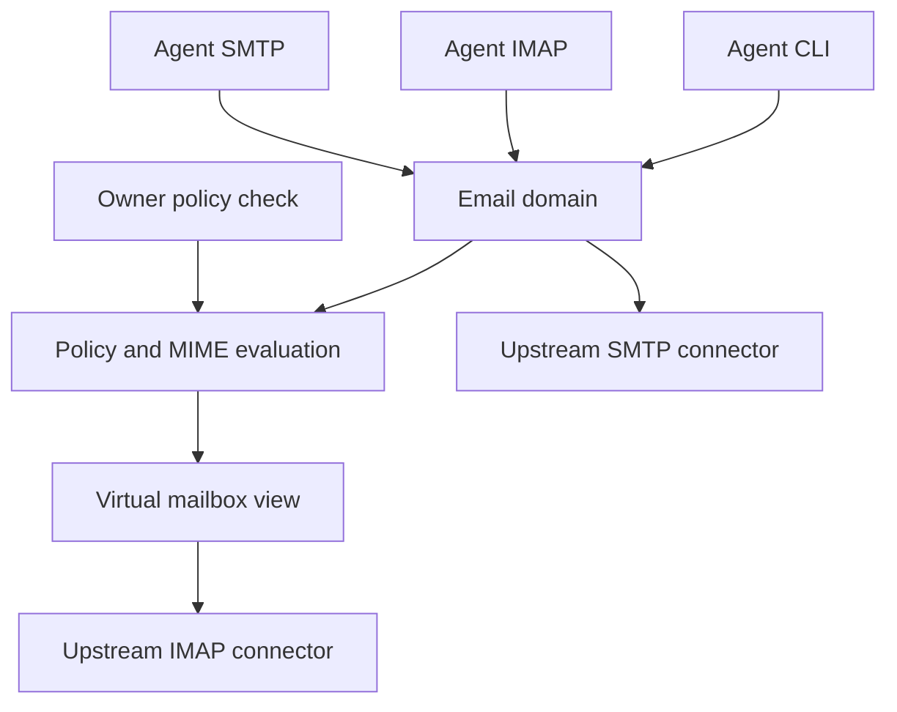
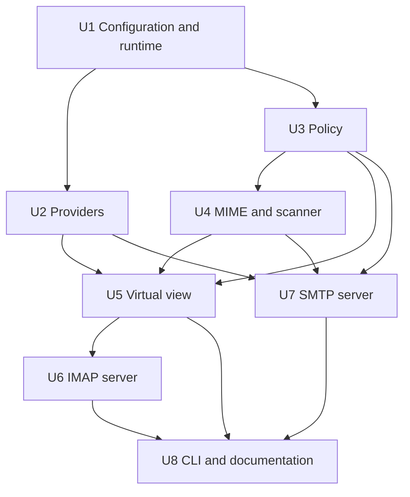

# feat: Build a policy-enforced email relay

## Summary

Build a Go CLI and local service whose IMAP, SMTP, and CLI entry points use one policy-enforced email domain. Agents receive a virtual mailbox with its own identifiers and counts; the owner configures upstream IMAP/SMTP accounts and agent profiles in YAML. Keep the core policy boundary reusable without implementing other resource types yet.

---

## Problem Frame

Giving an AI agent mailbox credentials grants it access to private folders, recovery emails, and unrestricted sending. Agent instructions or upstream IMAP search filters cannot enforce least privilege: clients can use different IMAP commands or SMTP directly. The owner needs a deterministic boundary that agents cannot bypass through another supported relay interface. The repository has no application files or prior patterns to preserve.

---

## Requirements

- **R1.** Run interactively until interrupted or as a managed, long-lived local service; support multiple upstream providers and distinct agent logins/profiles. Agent processes cannot read owner configuration, upstream credentials, or local relay state.
- **R2.** Owner YAML defines provider IMAP/SMTP connection, password/app-password lookup, listeners, agent authentication, and profiles. Reject malformed or ambiguous policy, default-deny, and warn on broad grants such as read-all folders; keep secrets out of examples and logs.
- **R3.** Explicit allow/deny rules grant `ro`, `rw`, or `wo` on folders and email addresses using exact, wildcard, or regex patterns. Deny wins. A readable message needs folder permission and, if address-read rules are configured, an address match. Incoming address matching examines available stored address headers; write-address rules constrain all actual and declared outgoing recipients.
- **R4.** Independently configurable inbound and outbound subject, body, attachment-presence, extension, and size rules; content can be hidden/rejected or safely sanitized. Link removal/replacement must not retain URL paths, queries, fragments, or credentials. Secret/recovery patterns are explicit rules; an optional, strongly recommended executable scanner can add best-effort detection. A configured check that errors, times out, or cannot inspect relevant content fails closed.
- **R5.** Denied folders and messages are absent from agent-facing listing, search, fetch, counts, flags, and notifications, regardless of the IMAP filter the agent supplies. Return a consistent sanitized representation through all read paths. A policy restriction takes effect immediately, terminating active sessions when a safe in-place update is not possible.
- **R6.** Authorized folder `rw` supports flags, move/copy, append, and deletion where both source and destination permissions allow it; `ro` cannot mutate, and operations targeting hidden messages cannot affect them. Mailbox create/rename/delete is allowed only where the entire operation remains inside explicitly writable scope.
- **R7.** SMTP/CLI sending checks authenticated agent, authorized sender/account, SMTP envelope and every To/Cc/Bcc recipient, outgoing content rules, and attachments before any upstream submission. Reject a message atomically if any recipient or check fails. By default, insert an agent-identifying header, with owner opt-out; never trust a client-supplied value for that header.
- **R8.** Provide owner-only configuration validation and a dry-run policy inspection command against representative or actual mail, with safe reasons and no unintended sends/mutations; document effective permissions, warning and detector limitations concisely.
- **R9.** Design an extension seam for future disk and Google Workspace relays without building or specifying their policy semantics in this release.

**Acceptance examples:** A profile allowed `INBOX/A` and `INBOX/B` cannot learn `INBOX/Private` through listing, selection, wildcard search, counts, or message identifiers. A message with a denied recovery subject in `INBOX/A` is equally invisible. A send to one allowed plus one denied recipient delivers to neither. A scanner failure never exposes a message or submits a send. CLI and protocol clients reach identical access decisions.

---

## Scope Boundaries

- V1 uses YAML and upstream IMAP/SMTP with username and password/app password; no POP3, TOML, OAuth/token-refresh, JMAP, native Gmail/Graph API, or Himalaya-config compatibility.
- Local trusted-host deployment only: agent processes are isolated from owner files, upstream credentials, and direct upstream connections. Remote/multi-tenant exposure is not a security promise.
- Logical mailbox invisibility covers observable IMAP/CLI results, not timing/resource side channels or information already obtained before a rule changed.
- No guarantee that heuristic secret/recovery detectors recognize every sensitive message or opaque attachment; explicit matches and fail-closed evaluation are the enforceable boundary.
- No general-purpose plugin framework, disk relay, or Google Workspace relay in v1.

### Deferred to Follow-Up Work

- POP3, TOML, OAuth-provider authentication, remote listeners, and non-email relays; evaluate each independently after the email security boundary is verified.

---

## Context & Research

### Relevant Code and Patterns

- Greenfield repository: no source, tests, `AGENTS.md`, `STRATEGY.md`, or `docs/solutions/` found in the checkout. Use simple Go packages and table-driven tests; avoid speculative abstractions for future tools.

### External References

- [go-imap v2](https://pkg.go.dev/github.com/emersion/go-imap/v2/imapserver) supplies IMAP server/client APIs, with a complete session interface, per-session updates, and configurable capabilities; as of research its latest tagged v2 is a **beta**, so pin and verify compatibility before implementation.
- [go-smtp](https://github.com/emersion/go-smtp) provides SMTP client and server APIs; [go-message](https://github.com/emersion/go-message) provides streaming MIME parsing/writing.
- [IMAP4rev2 RFC 9051](https://www.rfc-editor.org/rfc/rfc9051) requires consistent UID/UIDVALIDITY/UIDNEXT and sequence-number semantics. Raw upstream UIDs or UIDNEXT would expose hidden mail activity; virtual identifiers must belong to the filtered view.
- [Himalaya](https://github.com/pimalaya/himalaya) is a Rust mail client binary, not a server/backend library for this Go proxy; it does not remove the need for an IMAP/SMTP policy boundary.
- [Gitleaks](https://github.com/gitleaks/gitleaks) can scan stdin but is not an email-aware enforcement engine; its documented exit code 1 can represent a finding **or an error**, so a structured scanner contract must disambiguate these. It currently describes itself as feature-complete/security-fixes-only; do not hardwire the relay to it.

---

## Key Technical Decisions

| Decision | Rationale |
| --- | --- |
| Go, with separate email domain, upstream connector, IMAP/SMTP adapters, and CLI | Established libraries cover both ends of the protocols; every agent interface can call the same policy-enforced operations. No plugin system until a second relay exists. |
| Virtual per-agent/per-mailbox view with durable mapping for visible UIDs | Filtering upstream responses is not sufficient for sequence numbers, UIDNEXT, SEARCH, STATUS, IDLE, or stable client resynchronization. Persist mapping/UIDVALIDITY and assign virtual UIDs only to visible mail; do not persist raw message bodies by default. |
| Normalize and evaluate on decoded mail before exposure | Folded/encoded headers, multipart alternatives, nested MIME, embedded URLs, and raw/partial FETCH must not bypass rules; if a safe representation cannot be built, omit the message. Derive all IMAP metadata and body sections from that one representation. |
| Policy checked before and immediately around mutations and sends | Denied content must not be copied, moved, appended, marked, expunged, or sent through a different entry point. Avoid upstream operations on ambiguous/partially visible targets. |
| Restrict protocol surface to what is implemented safely | Do not advertise unimplemented extensions; reject unsupported commands and data shapes instead of forwarding them. Start with IMAP4rev1 capabilities and add optional extensions only after contract tests; required core commands remain implemented or fail explicitly. |
| Atomic policy generations | Validate a replacement policy before activating it; close existing IMAP sessions on tightening/any reload where revocation cannot be proven safe, invalidate views, and ensure new CLI/SMTP operations use the new generation. |
| Bounded scanner execution | Configure executable plus fixed arguments, no shell interpolation; pass bounded data on stdin, enforce timeout/resource limits, parse structured result, and hide/reject on malformed output or any inspection failure. Keep owner diagnostics free of raw secrets. |
| Owner-only administration distinct from agent login | A dry run on actual mail could expose restricted content; require owner OS-level access to local configuration/state and keep administrative commands unavailable on agent IMAP/SMTP credentials. |

---

## High-Level Technical Design

> *This illustrates the intended approach and is directional guidance for review, not implementation specification. The implementing agent should treat it as context, not code to reproduce.*



Treat read and send as separate policy pipelines. Reads enumerate only allowed folders, evaluate candidates before adding them to a virtual view, then answer *every* list/search/fetch/status operation from that view. Sends validate the complete envelope and message before SMTP submission; a permitted send never follows from mailbox `rw` alone. Folder read/write rights and address read/send rights are separate dimensions: a configured dimension requires its own allow, and any matching deny vetoes it. Exact/wildcard/regex syntax and `ro/rw/wo` are accepted in their proper dimension; invalid combinations fail configuration validation. Mail header Bcc is checked on incoming mail only if actually stored.

---

## Output Structure

```text
cmd/sireno/main.go
internal/config/          # YAML, credentials, validation
internal/policy/          # compiled rules and decisions
internal/mail/            # MIME, sanitation and scanner
internal/provider/        # upstream IMAP/SMTP
internal/view/            # per-agent virtual mailbox and UID mapping
internal/imap/            # agent-facing IMAP server
internal/smtp/            # agent-facing SMTP submission server
internal/cli/             # serve, agent commands and owner inspection
tests/integration/        # protocol and end-to-end security scenarios
docs/                    # setup, policy reference and threat model
```

---

## Implementation Units



### U1. Bootstrap configuration and local runtime

**Goal:** Load/validate owner YAML, agent credentials, listener addresses and process lifecycle.

**Requirements:** R1, R2, R9.

**Dependencies:** None.

**Files:** Create `go.mod`, `cmd/sireno/main.go`, `internal/config/config.go`, `internal/config/config_test.go`, `internal/cli/serve.go`, `internal/cli/serve_test.go`, `config.example.yml`.

**Approach:** Use a keyed provider/profile/user YAML shape rather than the nested single-key sequence in the sketch; make each agent reference a provider and profile explicitly. Keep agent credential references distinct from upstream secret-command references. Validate unknown fields, overlapping/invalid names, unsupported schemes, unsafe file permissions, and local-only listener defaults. Define bounded connection/message sizes and graceful Ctrl+C shutdown; support running the same foreground command under a user service manager, without daemonizing or installing services on behalf of the user.

**Patterns to follow:** No local precedent; standard Go package boundaries and table-driven tests.

**Test scenarios:**
- Happy path: two users with separate profiles and one provider load without inheriting one another's permissions.
- Edge case: no allow rules load as deny-all with a clear warning; a read-all folder rule produces a broad-access warning.
- Error path: duplicate keys, unknown fields, missing secret command, world-readable owner config, and non-local listener settings fail validation before binding.
- Integration: cancel the foreground runtime and observe clean listener closure with no further accepted logins.

**Verification:** A safe sample configuration validates and starts locally; unsafe or ambiguous configuration never partially starts.

### U2. Upstream IMAP/SMTP connectors

**Goal:** Read and mutate provider mailboxes and submit messages through TLS-authenticated upstream services.

**Requirements:** R1, R2, R6, R7.

**Dependencies:** U1.

**Files:** Create `internal/provider/imap.go`, `internal/provider/smtp.go`, `internal/provider/provider_test.go`, `tests/integration/provider_test.go`.

**Approach:** Expose a narrow email-specific provider interface used only by the domain; require TLS verification to upstream by default, support bounded password-command lookup without a shell, and keep provider credentials inaccessible to agent interfaces. Normalize provider-specific mailbox delimiter/name handling and errors before policy evaluation. Do not infer OAuth support from IMAP/SMTP protocol support.

**Patterns to follow:** `go-imap/v2` client, `go-smtp` client, small in-process fake upstreams for integration tests.

**Test scenarios:**
- Happy path: read a folder and submit a message via fake TLS upstream using a password supplied by a secret command.
- Error path: certificate mismatch, credential failure, timeout, and interrupted connection fail without fallback to plaintext or logging secrets.
- Integration: mutations against a fake upstream affect only the selected account and report an upstream failure without claiming success.

**Verification:** Both directions work against test servers; agent-visible diagnostics contain no upstream secrets.

### U3. Compile and enforce permission profiles

**Goal:** Define one explicit, testable authorization decision across all email operations.

**Requirements:** R2, R3, R6, R7.

**Dependencies:** U1.

**Files:** Create `internal/policy/policy.go`, `internal/policy/match.go`, `internal/policy/policy_test.go`, `internal/policy/match_test.go`.

**Approach:** Compile exact/glob/regex rules during config load; clarify folder vs. address rule namespaces and reject `wo` for folder reads, regex errors, and inconsistent match types. Treat folder-name canonicalization and INBOX specially, with deny evaluated against the canonical name. Evaluate address-read rules across actual stored From/To/Cc/Bcc headers and address-write rules over *all* SMTP envelope and declared To/Cc/Bcc recipients. A missing sender identity or recipient list is not a grant. Keep content read/send checks separate from structural grants.

**Execution note:** Implement policy truth-table tests before protocol adapters.

**Patterns to follow:** Pure Go evaluators without network or process dependencies.

**Test scenarios:**
- Happy path: an allowed folder plus matching address-read rule grants read; `ro` cannot mutate while `rw` can; `wo` can send but not read.
- Edge case: an allowed folder with no address-read rules needs no address match, but once configured, a nonmatching address denies read; deny always wins over `ro:*` or `rw:*`.
- Edge case: wildcard and regex matches honor documented boundaries; Unicode/case, encoded names and provider aliases cannot evade a deny; absent Bcc is never fabricated as a match.
- Error path: unknown mode, unbounded or invalid regex, conflicting/unknown profile reference, and unsupported rule combination fail closed at validation.

**Verification:** A single decision trace explains effective owner policy without exposing private content to the agent.

### U4. Evaluate and sanitize MIME and optional scanner output

**Goal:** Hide forbidden mail and provide one safe, self-consistent representation of permitted mail.

**Requirements:** R4, R5, R7.

**Dependencies:** U3.

**Files:** Create `internal/mail/message.go`, `internal/mail/sanitize.go`, `internal/mail/scanner.go`, `internal/mail/message_test.go`, `internal/mail/sanitize_test.go`, `internal/mail/scanner_test.go`, `tests/integration/scanner_test.go`.

**Approach:** Decode headers and MIME parts under size/depth/charset limits. Apply inbound and outbound rules independently. On read, sanitize links across plain text and HTML and strip sensitive link-bearing headers/embedded parts; derive envelope, BODYSTRUCTURE, sizes and body sections from the same sanitized bytes. Reject/hide encrypted, signed, malformed, unsupported, oversized, or incompletely inspected content rather than exposing raw originals; rewriting signed mail must not imply signatures remain valid. Scanner input/output is bounded, versioned, parsed, time-limited, and no-shell; provide a documented adapter example for Gitleaks but do not mistake its exit status alone for a valid finding.

**Execution note:** Begin with adversarial MIME fixtures, then implement transformations.

**Patterns to follow:** `go-message` MIME parser/writer; structured test fixtures in `tests/fixtures/mail/`.

**Test scenarios:**
- Happy path: an allowed message with HTML and text links yields sanitized bodies and matching structure/size; forbidden subject/body makes the message invisible.
- Edge case: encoded/folded subject, multipart alternatives, nested `message/rfc822`, attachment filename/extension and exact size threshold are inspected consistently.
- Edge case: URL with userinfo, path, query, fragment, encoded forms or HTML attribute cannot leak its original target through any returned part/header.
- Error path: malformed MIME, unknown charset, excessive nesting, encrypted part, scanner timeout/crash/malformed output/too-large input hides reads and rejects sends.
- Integration: sample Gitleaks adapter distinguishes clean, finding and tool failure using structured results.

**Verification:** No raw FETCH path or alternate MIME part can disclose content hidden or sanitized by the evaluator.

### U5. Materialize policy-defined mailbox views

**Goal:** Present stable per-agent folder/message identities derived only from permitted and evaluated mail.

**Requirements:** R3, R5, R6.

**Dependencies:** U2, U3, U4.

**Files:** Create `internal/view/view.go`, `internal/view/store.go`, `internal/view/view_test.go`, `internal/view/store_test.go`, `tests/integration/view_test.go`.

**Approach:** Keep durable *metadata-only* virtual UID/UIDVALIDITY mapping in owner-protected state; never expose upstream UIDNEXT, mailbox counts, flags or unsolicited updates. Build snapshot/search results over evaluated visible messages and sanitized bytes; visible UIDs must increase without reuse and preserve client resync rules across restart. Map sequence numbers only within the visible selected snapshot. Do not let a stale snapshot authorize a mutation; on policy reload invalidate views and revoke connections before they can issue more commands. For changes in provider content after exposure, only update visibility via protocol-consistent expunge/resync or close the session safely.

**Patterns to follow:** RFC 9051 identifier and resynchronization invariants; narrow view API shared by CLI and IMAP.

**Test scenarios:**
- Happy path: one allowed and two denied messages yield one visible count, one search hit, consistent FETCH sections, virtual UID and UIDNEXT across restart.
- Edge case: inserting a hidden upstream message does not change any agent-visible UIDNEXT/count/notification; another agent profile gets a different view.
- Edge case: upstream deletion/move, new visible mail, and policy reload preserve monotonic virtual identities or force protocol-safe resync.
- Error path: store corruption, evaluation failure or upstream timeout yields no raw fallback and no stale authorization.
- Integration: tightening policy while a mailbox is selected closes/revokes the active connection before it can fetch previously visible content.

**Verification:** Visibility, identifiers, and subsequent mutation targets agree under restarts and concurrent upstream changes.

### U6. Serve agent-facing IMAP

**Goal:** Offer ordinary mail clients a safe mailbox and bounded management operations.

**Requirements:** R1, R3, R5, R6.

**Dependencies:** U1, U5.

**Files:** Create `internal/imap/server.go`, `internal/imap/session.go`, `internal/imap/session_test.go`, `tests/integration/imap_test.go`.

**Approach:** Authenticate only configured agent users over loopback with TLS or a documented same-host trusted transport. Implement `LIST`/`LSUB`, `SELECT`/`EXAMINE`, `STATUS`, `SEARCH`/`UID SEARCH`, all supported `FETCH` variants, `STORE`, `COPY`/`MOVE` when advertised, `APPEND`, and safe `EXPUNGE`/mailbox management using the view API. Choose an explicit capability subset and test every advertised feature; do not forward raw provider commands. Require writable permission for both endpoints of moves/copies; prohibit `EXPUNGE` from touching hidden upstream messages even if marked deleted elsewhere. Limit failures on nonexistent and forbidden folders to indistinguishable agent-facing responses.

**Execution note:** Start with an external-client protocol test for hidden-folder and hidden-message non-disclosure.

**Patterns to follow:** `go-imap/v2/imapserver` session contract and RFC 9051 semantics.

**Test scenarios:**
- Happy path: real IMAP client can authenticate, list only allowed folders, search/fetch only visible mail and update flags in an `rw` folder.
- Edge case: `STATUS`, `EXAMINE`, UID ranges, partial/header/BINARY fetch if advertised, IDLE/POLL updates, LIST wildcards and cross-folder copy never expose or affect denied mail.
- Error path: hidden folder SELECT/STATUS and nonexistent folder return equivalent results; `ro` STORE/APPEND/DELETE and invalid source/destination are rejected without upstream side effects.
- Integration: remote policy change and concurrent selected sessions cannot continue fetching denied content.

**Verification:** A protocol-conformance/bypass suite exercises every advertised command against a mixed-visibility fixture; unsupported extensions remain unadvertised.

### U7. Serve agent-facing SMTP submission

**Goal:** Authenticate and authorize whole outgoing messages before forwarding any of them.

**Requirements:** R1, R3, R4, R7.

**Dependencies:** U1, U2, U3, U4.

**Files:** Create `internal/smtp/server.go`, `internal/smtp/submit.go`, `internal/smtp/submit_test.go`, `tests/integration/smtp_test.go`.

**Approach:** Require agent authentication, bind user to permitted provider/sender, buffer the complete message under strict size limits, check all SMTP envelope recipients and parsed To/Cc/Bcc (including duplicate/encoded forms), evaluate content, then submit once upstream. Strip client-supplied identity headers and generate trusted header unless opted out; preserve only permitted header values. Do not claim end-to-end transactionality after upstream accepts a submission; return an explicit uncertain outcome on ambiguous network failure rather than silently retrying and duplicating mail.

**Execution note:** Write mixed-allowed/denied-recipient tests before connecting upstream delivery.

**Patterns to follow:** `go-smtp` authenticated submission server and client.

**Test scenarios:**
- Happy path: one allowed destination submits once with correct agent header; opt-out suppresses header.
- Edge case: mixed allowed/denied envelope recipients and headers, Bcc, malformed address, and mismatched sender all reject with zero upstream sends.
- Error path: scanner failure, unsupported attachment, over-limit body, and provider disconnection fail closed; no secret is present in logs.
- Integration: SMTP result matches the equivalent CLI send decision for the same agent and message.

**Verification:** Every denied send causes zero upstream submission; approved sends carry a non-spoofable agent identity when enabled.

### U8. Expose agent CLI, owner diagnostics, and concise documentation

**Goal:** Make the relay usable and auditable without creating a second authorization path.

**Requirements:** R1, R5, R7, R8, R9.

**Dependencies:** U1, U5, U6, U7.

**Files:** Create `internal/cli/mail.go`, `internal/cli/check.go`, `internal/cli/mail_test.go`, `internal/cli/check_test.go`, `tests/integration/parity_test.go`, `README.md`, `docs/configuration.md`, `docs/policy.md`, `docs/security.md`, `docs/operations.md`, `docs/examples/relay.service`.

**Approach:** Agent CLI list/search/read/mutate/send delegates to the same domain as protocols and authenticates as an agent without exposing upstream credentials. Owner check commands validate config, explain effective rules, warn on broad grants, and dry-run actual mail only when run under owner OS identity; redact sample content in output. Document a runnable YAML sample, standalone and service-manager setup, permission examples, syntax/directions, profile reload, scanner command protocol/Gitleaks adapter, threat boundary, unsupported mail formats, and protocol capability matrix. Show future relay names as roadmap only.

**Patterns to follow:** Thin CLI over email-domain operations; no alternate policy evaluator.

**Test scenarios:**
- Happy path: CLI and IMAP show the same visible message set; CLI and SMTP deny the same unauthorized send.
- Edge case: owner dry run of a hidden recovery email reports the deny reason without printing subject/body to an agent; broad read wildcard emits a warning.
- Error path: agent identity cannot run privileged inspection or access provider credentials; failed validation never modifies state or sends mail.
- Integration: documented YAML starts a foreground service, cleanly stops on interrupt, and works under a user service manager.

**Verification:** An owner can configure, preview, run, and diagnose the relay from the docs; parity tests demonstrate one policy boundary.

---

## System-Wide Impact

- **Interaction graph:** Agent CLI/IMAP/SMTP → email domain → policy/MIME evaluation → virtual view or upstream submission. Owner inspection calls the same evaluator, under separate authority.
- **Error propagation:** Invalid config prevents startup; ambiguous/unsupported content denies read/send; provider outages never fall back to raw content or unfiltered results.
- **State lifecycle risks:** Virtual UID mapping, concurrent provider changes, policy reload, in-flight SMTP submission, and agent-visible cached sanitized messages require explicit tests and clear limits.
- **API surface parity:** All three agent entry points enforce identical authz; protocol capabilities are limited to operations tested against the virtual view.
- **Integration coverage:** Run local fake upstream IMAP/SMTP plus external agent clients over mixed-visibility mailboxes, changing policies and upstream mail during active sessions.
- **Unchanged invariants:** The upstream mailbox remains owner-owned; no agent receives upstream credentials or raw restricted mail.

---

## Risks & Dependencies

| Risk | Mitigation |
| --- | --- |
| `go-imap/v2` is tagged beta | Pin a tested version; run server/client compatibility spike at start of U6; if session semantics are inadequate, reassess a maintained Go alternative before building a custom protocol stack. |
| Full-mail inspection before accurate counts/search can be slow | Set bounded scan budgets, fail closed on incomplete evaluations, and measure realistic mailbox sizes; only introduce safe caching after correctness tests. |
| MIME/URL sanitization can leave hidden data in partial fetches or headers | Build one sanitized message, derive every field from it, use adversarial fixtures, and hide unsupported constructs. |
| Virtual UID state corruption/reuse or stale sessions can reveal information | Owner-protected durable metadata, monotonic IDs, revocation tests, and fail-closed resync when invariants cannot be maintained. |
| External scanner false negatives and untrusted-process risk | Describe it as best effort, require explicit regex blocks for known sensitive patterns, run fixed executable with limits, isolate it under owner-controlled install. |
| Upstream SMTP can accept before a connection fails | No automatic retry after uncertain acceptance; report ambiguity to operator to avoid duplicates. |
| Agent can bypass proxy if it has upstream credentials/network or owner file access | Document/enforce OS permission prerequisites; test separate agent identity and owner-only files. |

---

## Open Questions

### Resolved During Planning

- **Stack/config:** Go with the relay's own YAML schema; no Himalaya compatibility or Rust subprocess dependency.
- **Provider auth:** Username with password/app password (including secret-command lookup), not OAuth in v1.
- **Client interfaces:** CLI and IMAP/SMTP both required; POP3 deferred.

### Deferred to Implementation

- **Dependency versions/storage engine:** Pin supported versions and choose a local metadata store after verifying migration, permissions, and UID invariants; do not add persistent raw-body caching by default.
- **Provider quirks:** Validate folder delimiters, special folders, and IMAP extension behavior against at least one local test server and one real provider before advertising compatibility claims.
- **Scanner adapter contract:** Finalize machine-readable clean/finding/error responses and Gitleaks wrapper after verifying installed binary versions; never equate a nonzero exit code with a valid finding.

---

## Documentation / Operational Notes

- Make the safe path the first README example: owner-only config, agent-only credentials, local listeners, restricted folder and recipient rules, config check, foreground run, then user-service deployment.
- Document that visibility guarantees apply to all agent-facing operations, but not to timing, previously fetched/cached messages, or direct upstream access. Note limits of optional detection and incoming Bcc headers.
- Keep security diagnostics as rule IDs and coarse reasons; never print full messages, scanner findings, credentials, or raw protocol debug streams in routine logs.
