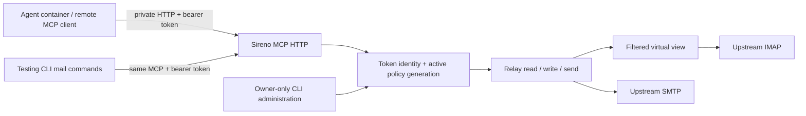

# feat: Replace agent mail protocols with token-authenticated MCP

## Summary

Make Sireno a trusted Streamable HTTP MCP service. A bearer token selects exactly one user, provider, and policy; agents use MCP tools and testing-only mail CLI commands call the same MCP endpoint. Preserve upstream IMAP/SMTP and the existing filtered mailbox, extend it with policy-safe writes, and remove agent-facing IMAP/SMTP listeners for now.

---

## Problem Frame

The existing local IMAP/SMTP facade is expensive to make protocol-complete and safely writable; the CLI currently depends on it and the upstream provider has no mutation methods. Agents may run in a separate container on the same Docker host. Merely running a local client with owner credentials would let an agent bypass filtering. This plan supersedes the agent-facing interface and deployment choices in `docs/plans/2026-10-12-001-feat-policy-enforced-email-relay-plan.md` while retaining its default-deny and fail-closed mail guarantees.

---

## Requirements

- **R1.** Serve remote MCP clients via Streamable HTTP on a dedicated same-host Docker network. Each HTTP request must have an opaque bearer token identifying one configured user; never derive authority from arguments or a protocol session. Reject invalid, revoked, or missing credentials without leaking user existence.
- **R2.** Keep owner YAML and upstream credentials private to Sireno. Token issuance/rotation is owner-controlled; protect token material in configuration, CLI arguments, HTTP logs, error responses, and client examples. Policy/token changes must affect the next request, the next read response, and pre-commit authorization checks. On a changed but invalid owner configuration, suspend agent operations until a valid generation is installed and alert the owner; never silently keep revoked access alive.
- **R3.** Expose policy-filtered folder listing, message listing/search, sanitized read, and sending via bounded MCP tools. Hidden folders/messages and upstream identifiers/counts must not be observable. Sending validates sender, complete envelope and declared recipients, outbound content and agent header before one upstream submission.
- **R4.** Expose safe message flag updates, copy/move, append, targeted deletion, and folder management for explicitly writable scopes. Stale virtual IDs, hidden messages, source/destination permission failures, implicit bulk effects, or uninspectable inputs must fail closed. Handle uncertain partial upstream outcomes explicitly.
- **R5.** All agent mail CLI commands accept the same token, act as an MCP client of the same server (never load owner config or connect directly upstream), and warn that the CLI is for testing; owner-only administrative commands remain separate.
- **R6.** Preserve strict YAML validation, existing policy and MIME/scanner guarantees, owner diagnostics, and upstream TLS IMAP/SMTP. Remove agent-facing IMAP/SMTP listeners and their password-login config. Provide examples with an agent–relay-only internal Docker network, a separate relay-only outbound path, no published MCP port by default, and no certificates for same-host use; HTTPS is mandatory before cross-host exposure.

**Acceptance cases:** Two user tokens yield distinct filtered views; rotating/removing one token denies its next request. CLI and MCP deny the same hidden read and mixed-recipient send. An `rw` mutation cannot touch a hidden or stale message, even when another actor set `\\Deleted` on it. Malformed mail and scanner errors never become visible or writable. An agent container cannot read owner files or use the upstream credentials.

---

## Scope Boundaries

- No agent-facing IMAP/SMTP endpoints in this release; upstream IMAP/SMTP connectors remain.
- No direct, privileged mail CLI fallback, raw upstream command tool, Himalaya account-file compatibility, OAuth/OIDC, or claim of full MCP OAuth authorization conformance. Provisioned static bearer tokens are a private integration contract; intended clients must support configured headers.
- No TLS termination for the dedicated same-host Docker-network deployment. Cross-host or untrusted-network use is unsupported until HTTPS and a revised network threat model are added.
- No guarantee of exactly-once SMTP delivery after ambiguous upstream acceptance, rollback of partial IMAP operations, revocation of already-delivered content, or hiding timing/resource side channels.
- No blanket mailbox-wide expunge or deletion of a folder containing content that cannot be proven both visible and writable. Unsupported provider mutation semantics fail closed rather than partially emulating writes. Standard IMAP cannot make an inspection and later upstream mutation transactional against independent mailbox actors; document the remaining narrow race rather than promising impossible atomicity.

### Deferred to Follow-Up Work

- Agent-facing IMAP/SMTP adapters and normal mail-client compatibility; OAuth-based MCP authorization; cross-host TLS/reverse proxy; other relays (disk/Google Workspace).

---

## Context & Research

### Relevant Code and Patterns

- `internal/config/config.go` enforces owner-only YAML, named providers/profiles/users, and env-expanded values; its current `users.password` and `listen.imap/smtp` belong to the retired agent protocols.
- `internal/policy/policy.go`, `internal/mail/message.go`, and `internal/relay/relay.go` implement the shared policy and sanitized read/send path; `relay.Current` checks for changes but does not coordinate atomic policy generations around provider I/O.
- `internal/view/view.go` persists per-user virtual IDs and filtered snapshots; its current upstream mapping does not include upstream UIDVALIDITY, which writes require.
- `internal/provider/provider.go` supports listing, reading, and sending but no writes; `internal/imap/server.go` rejects writes; `cmd/sireno/main.go` connects to the existing agent-facing protocols. Keep existing package-local fake-provider tests as characterization coverage before replacing the adapters.
- `README.md`, `docs/configuration.md`, `docs/security.md`, `docs/operations.md`, and `docs/examples/relay.service` currently describe the old interface. Existing working-tree changes and untracked `config.yml` must be preserved; the plan does not authorize editing that private file.
- No `docs/solutions/` learnings or existing Docker/HTTP MCP pattern in this repo.

### External References

- [MCP Streamable HTTP transport](https://modelcontextprotocol.io/specification/2025-11-25/basic/transports) requires `Origin` validation; authenticate every request rather than using a session ID as identity. [Authorization specification](https://modelcontextprotocol.io/specification/2025-11-25/basic/authorization) defines OAuth; our pre-shared tokens intentionally do not implement OAuth discovery.
- [Official Go MCP SDK](https://github.com/modelcontextprotocol/go-sdk) supports Streamable HTTP and tool registration. Verify interoperability against the actual client: OpenCode V2 defaults to the `2025-11-25` initialization flow but can negotiate newer protocol revisions via its `protocol` setting; do not assume latest-only SDK mode works for that default.
- [OpenCode V2 remote MCP configuration](https://opencode.ai/v2/docs/mcp-servers) supports custom `Authorization` headers with environment substitution and `oauth: false`.
- [RFC 9051 UID/UIDVALIDITY](https://www.rfc-editor.org/rfc/rfc9051.html#section-2.3.1) makes mailbox UIDVALIDITY part of upstream message identity. [Docker networking](https://docs.docker.com/engine/network/) provides container DNS on user-defined networks but a private network does not itself authenticate callers.

---

## Key Technical Decisions

| Decision | Rationale |
| --- | --- |
| One authenticated relay domain, thin MCP adapter and HTTP-only agent CLI | Avoid alternate policy paths; keep the agent container away from upstream secrets. Owner-only `serve`/`config-check` can load owner YAML locally; mail commands cannot. |
| Cryptographically random high-entropy per-user bearer token with its verifier in the owner-only YAML; no user-selection tool argument | Token possession selects exactly one identity. The owner provisions the raw token only to its agent and writes only a non-reversible verifier suited to random tokens into YAML. Rotate via an atomic owner config-file replacement that the running server checks before the next request; no default old/new overlap. Avoid verifier indirection through environment or separately mounted secret files, whose updates cannot be observed reliably on the same reload path. |
| Authenticate every supported HTTP method and recheck the active generation before read responses and irreversible mail I/O | A failed reload of a changed file suspends agent access and alerts the operator rather than retaining a revoked token. Bind any SDK session to its token identity or use verified stateless mode; never trust a session as credentials. Do not claim rollback once upstream commits. |
| Initial MCP compatibility target: Streamable HTTP using an SDK mode verified with OpenCode V2 default `initialize` (2025-11-25) | Client interoperability takes precedence over newest-protocol-only features. Test other protocol versions only when needed; no raw JSON-RPC implementation unless SDK cannot meet the contract. |
| Bounded virtual-ID read/write API tied to user, provider, folder, upstream UIDVALIDITY, UID, and evaluated content fingerprint | Revalidate current content/permissions before targeted writes; never interpret a stale virtual ID as a different upstream message or leak upstream IDs/UIDNEXT. Provider capability checks must establish the actual upstream targeting guarantees before each type of write is exposed. |
| `rw` only enables demonstrably safe scoped mutations | Authorize source and destination, preflight all targets, reject hidden/stale items, use targeted UID operations, and reject unsupported atomicity instead of using blanket expunge or folder deletion. No implicit address-send grant from folder `rw`. |
| Dedicated internal agent–relay Docker network plus relay-only egress, no published listener by default | An agent container resolves the relay by network alias but has no route to upstream email; the trusted relay has a second network path for upstream connections. Listen on the internal container interface; keep owner config/state mounts and Docker socket out of the agent, and document HTTP token sniffing risk from compromised same-network peers. |

---

## High-Level Technical Design

*This illustrates the intended approach and is directional guidance for review, not implementation specification. The implementing agent should treat it as context, not code to reproduce.*

The initial tool catalogue covers folder list, message list/search/read, message flags/copy/move/append/targeted-delete, folder create/rename/delete where provably safe, and send. All result sets are bounded and paginated over filtered views. An unauthorized folder/message has the same agent-facing unavailability result as a nonexistent one. Bulk writes preflight every target; if the provider cannot guarantee targeted effects, reject the operation. Report an explicit unknown/partial result for failures after an upstream acceptance and do not automatically replay sends or destructive operations.

---

## Implementation Units

### U1. Define token identities and active configuration generations

**Goal:** Replace agent password login with owner-provisioned per-user token verification and safe reload semantics.

**Requirements:** R1, R2, R6.

**Dependencies:** None.

**Files:** Modify `internal/config/config.go`, `internal/config/config_test.go`, `internal/relay/relay.go`, `internal/relay/relay_test.go`, `config.example.yml`; create `internal/relay/auth_test.go`.

**Approach:** Preserve owner-only YAML validation and provider passwords, but replace the user password field with a token verifier configuration and MCP listener. Define operator rotation as atomic replacement of owner-only YAML containing token verifiers, not plaintext; fail startup on duplicates, weak token configuration or unsafe file permissions. Observe config-file changes before each request and atomically install only fully validated policy/token sets, making revocation effective on the next request. If the file changes but fails validation, suspend agent traffic and surface an operator diagnostic until corrected; do not keep the last permissive generation serving. Do not claim that a changed environment variable or mounted secret updates a running container's verifier without an explicit restart. Recheck current generation for reads and immediately before upstream writes/sends, while documenting the point after which acceptance cannot be undone.

**Patterns to follow:** `internal/config/config.go` strict decoding, `internal/relay/relay.go` existing identity/policy checking.

**Test scenarios:**
- Happy path: two tokens map to different user/provider/profile pairs; identical mail requests receive different allowed views.
- Edge case: atomically replace owner YAML to remove or rotate one token and retry on an existing MCP client connection; old token is denied, other token remains valid without restarting the server.
- Error path: duplicate verifier, missing token, malformed YAML, missing env reference, weak token, and insecure config file fail without partially activating new policy; an invalid changed file denies further agent requests until repaired rather than retaining a revoked token.
- Integration: policy tightens between authorization and an upstream send/write; the operation is rejected before the upstream effect unless the already-started irreversible commit makes the outcome explicitly uncertain.

**Verification:** A token can never select another identity, and failed reloads suspend agent requests with an operator-visible warning until corrected.

### U2. Harden the virtual view and implement targeted provider writes

**Goal:** Supply safe identities and provider primitives for scoped mutable mail.

**Requirements:** R3, R4.

**Dependencies:** U1.

**Files:** Modify `internal/view/view.go`, `internal/view/view_test.go`, `internal/provider/provider.go`, `internal/policy/policy.go`, `internal/policy/policy_test.go`; create `internal/provider/provider_test.go`, `internal/view/mutation_test.go`.

**Approach:** Include upstream UIDVALIDITY and an evaluated-content fingerprint in each virtual message identity without exposing upstream identifiers; invalidate stale mappings when a mailbox is recreated, content changes, or a folder is renamed. Use UID-scoped primitives for mutations of existing messages with explicit result semantics and per-operation capability gates; append and folder management have their own safety preconditions. Authorize `rw` on every relevant source/destination; re-fetch and re-evaluate target content immediately before the narrow upstream operation. Require UID-targeted expunge support for permanent deletion, or withhold that tool for that provider; never blanket-expunge. For append, validate the entire proposed message as visible and permitted before inserting it. Folder deletion/rename needs proof that the operation cannot affect hidden content; otherwise withhold it. Preflight all batch targets before the first effect; if the provider partially commits, report partial/unknown outcome rather than promising atomicity against independent mailbox actors.

**Execution note:** Characterize virtual-ID reuse and hidden-message behavior before changing mapping logic; implement write safety tests first.

**Patterns to follow:** `internal/view/view.go` virtual snapshots, `internal/mail/message.go` fail-closed evaluation, `internal/policy/policy.go` deny-overrides-allow.

**Test scenarios:**
- Happy path: flag/move/copy a visible message between writable folders; a newly appended allowed plain-text message appears with a virtual ID.
- Edge case: recreate upstream mailbox with the same UID but new UIDVALIDITY, then mutate with old virtual ID; no upstream action occurs. Inserting hidden messages never changes visible IDs/counts.
- Error path: hidden or now-denied target, `ro` source, denied destination, unsupported MIME on append, and mixed-visibility batch cause zero upstream changes.
- Integration: hidden `\\Deleted` mail and a targeted deletion of visible mail never cause upstream expunge of the hidden message; a folder with hidden mail cannot be deleted as a side effect. Change message content or UIDVALIDITY between list and write; the stale ID cannot affect a replacement message. Concurrent external changes exercise the provider capability gates and documented residual race.

**Verification:** No mutation takes an upstream UID or a raw mailbox-wide effect supplied by the agent; provider failures never fall back to unfiltered data.

### U3. Publish bounded MCP read, write, and send tools

**Goal:** Expose one agent-facing mail contract through authenticated Streamable HTTP.

**Requirements:** R1, R2, R3, R4.

**Dependencies:** U1, U2.

**Files:** Create `internal/mcp/server.go`, `internal/mcp/server_test.go`, `internal/mcp/tools_test.go`; modify `internal/relay/relay.go`, `internal/relay/relay_test.go`, `go.mod`, `go.sum`.

**Approach:** Wrap the official Go SDK HTTP handler with request-body limits, timeouts, strict Origin checks, and per-request token authentication on every supported method. Bind verified identity to request context and any SDK session, reject cross-token session reuse, never trust user or provider IDs from tool arguments, and avoid logging tokens or raw mail. Recheck token/policy generation before returning a read response. Tool results use only filtered virtual IDs and sanitized content, bounded search/page/read output; opaque pagination cannot leak upstream positions or hidden counts. Send enforces all envelope/declared recipients and reports ambiguous upstream acceptance distinctly. Verify OpenCode's default protocol handshake and standard tool calls; keep private bearer auth explicit, not advertised as OAuth.

**Execution note:** Start with black-box HTTP tests for hidden-data disclosure and token isolation before expanding the tool catalogue.

**Patterns to follow:** `internal/relay/relay.go` send pipeline, `internal/view/view.go` filtered snapshots, `internal/mail/message.go` bounded content rules.

**Test scenarios:**
- Happy path: authorized MCP client discovers tools, lists allowed folders, searches/reads one sanitized visible message, sends once, and mutates only `rw` targets.
- Edge case: filtered pagination/search changes, hidden folder lookup, deleted or stale virtual ID, concurrent users, active-token rotation and cross-token session reuse reveal no hidden counts, raw IDs, or another user's content; authenticate session-bound GET/DELETE as well if the selected SDK mode supports them.
- Error path: missing/bad/revoked bearer token, malformed MCP body, invalid Origin, oversized input, scanner failure, denied mixed recipients, and provider outage fail closed with redacted errors.
- Integration: OpenCode V2's default remote MCP handshake with configured header successfully reaches a tool; losing an upstream send acknowledgment reports uncertainty and does not auto-resubmit.

**Verification:** Every exposed tool traverses token identity and relay authorization; no raw-provider or owner-administration tools appear.

### U4. Replace agent protocol CLI with a token-authenticated MCP client

**Goal:** Make agent CLI testing an alternate presentation of the same remote interface, never an alternate authority.

**Requirements:** R2, R3, R4, R5.

**Dependencies:** U3.

**Files:** Modify `cmd/sireno/main.go`, `cmd/sireno/main_test.go`, `Makefile`; create `internal/mcp/client_test.go` if an internal shared MCP client is needed.

**Approach:** Keep `serve` and `config-check` owner-only; require a token and explicit endpoint for every `mail` command and call the same MCP tools as agents. Preserve scriptable stdout for mail and keep a clear security warning on stderr on every mail invocation; do not put tokens on the command line, in logs, or in process arguments. Reject URL userinfo, credential-bearing redirects and ambient HTTP proxies; permit plain HTTP only for documented internal-network endpoints and otherwise require HTTPS. Remove CLI IMAP/SMTP dial and password-login code. Test result parity via the HTTP boundary instead of calling the relay internally.

**Patterns to follow:** Cobra/Viper command tree in `cmd/sireno/main.go` and existing PTerm diagnostic output.

**Test scenarios:**
- Happy path: CLI list/read/flag/send with a token and MCP URL matches tool responses and emits a warning only on stderr.
- Edge case: denied user cannot pick another user with a CLI flag; piping raw message output is not corrupted by diagnostics.
- Error path: absent token, unreachable MCP endpoint, revoked token, URL userinfo, redirect, proxy environment, invalid URL, or unsupported write operation returns a meaningful error without reading owner YAML, connecting upstream, or printing the token.
- Integration: the same denied message and mixed-recipient send are rejected identically from direct MCP and mail CLI.

**Verification:** `mail` works from an agent-only container with just URL/token; no owner config is available in that environment.

### U5. Retire agent-facing listeners and document isolated deployment

**Goal:** Remove obsolete agent protocols from the shipped runtime and document a reproducible same-host container boundary.

**Requirements:** R1, R2, R5, R6.

**Dependencies:** U3, U4.

**Files:** Modify `cmd/sireno/main.go`, `cmd/sireno/main_test.go`, `docs/examples/relay.service`, `README.md`, `docs/configuration.md`, `docs/security.md`, `docs/operations.md`; delete or remove from build `internal/imap/server.go`, `internal/smtp/server.go` and their obsolete agent-facing tests; create `docs/examples/compose.yml`, `tests/integration/mcp_boundary_test.go`.

**Approach:** Stop binding IMAP/SMTP listeners; retain upstream connectors and required libraries. Provide owner-only container mounts and token distribution, a dedicated internal agent–relay network and a separate relay-only outbound path for upstream IMAP/SMTP, no host-published MCP port by default, separate container privileges, a reachable container-interface listener, and CLI testing from a container on the internal network. Assert/document deployment checks because an application inside a container cannot reliably detect a Docker host port publication on its own. Describe same-network sniffing/compromised peers, direct upstream access, and the requirement for HTTPS if leaving one trusted host. Update configuration/migration guidance, especially removing `users.password` and `listen.imap/smtp`; do not modify untracked local `config.yml` without operator action.

**Patterns to follow:** `docs/security.md` explicit threat limits, `docs/configuration.md` field-by-field examples, `docs/examples/relay.service` owner-only runtime example.

**Test scenarios:**
- Happy path: documented two-container setup connects with an agent token, reaches only filtered MCP tools, and shuts down cleanly.
- Edge case: relay has no agent-facing IMAP/SMTP ports, no host-published MCP port, and no owner secret/state mount, Docker socket, extra outbound network or host-network mode in the agent container.
- Error path: invalid listener/bind, missing token or upstream secrets, and direct read of owner config from the agent container are denied; the server never starts with a partial config.
- Integration: an agent container cannot use its mounts, network access, or exposed processes to obtain upstream credentials or connect directly to upstream mail endpoints; a revoked token stops its next HTTP request.

**Verification:** The security guide and sample deployment match the actual network/filesystem boundaries; docs contain no example live tokens.

---

## System-Wide Impact

- **Interaction graph:** Agent MCP and testing CLI → HTTP authentication → generation-scoped relay decisions → virtual view/provider; owner CLI config check remains local and trusted.
- **Error propagation:** Authentication errors are generic; denied and nonexistent mail are indistinguishable where appropriate; upstream/parse/scanner errors never emit raw mail or success-shaped empty results.
- **State lifecycle risks:** Token reload, in-flight send/write, UIDVALIDITY reuse, concurrent operations, partial IMAP mutations, stale search pagination, lost HTTP responses after SMTP acceptance.
- **API surface parity:** Direct MCP tools and mail CLI invoke the same HTTP contract; removed IMAP/SMTP endpoints cannot provide bypasses. Owner administration is not an agent tool.
- **Integration coverage:** Fake upstream servers plus actual MCP HTTP client, two user tokens, policy reload during active requests, and deployment-level container isolation checks.
- **Unchanged invariants:** The provider credentials remain owner-only; policy is default-deny, scanner failures fail closed, and no raw hidden mail or upstream identifiers are returned.

---

## Risks & Dependencies

| Risk | Mitigation |
| --- | --- |
| Go SDK revision and OpenCode client mismatch | Pin/test official Go SDK with OpenCode V2 default initialization; choose negotiated revision based on a real compatibility fixture, not newest-only assumptions. |
| Custom bearer tokens are not MCP OAuth | Document static-header requirements and lack of discovery/refresh; never claim standard OAuth compliance. |
| Non-TLS HTTP leaks tokens to compromised peers on the network | Use a dedicated same-host Docker network, minimize peers/privileges, never publish by default, require HTTPS for cross-host traffic. |
| Docker topology inadvertently gives agent owner files or alternate mail path | Internal agent–relay network, relay-only outbound network, explicit separate mounts/users, no Docker socket, deployment tests verifying upstream is unreachable from agent and documented limits of host-root compromise. |
| TOCTOU/reload between authorization and upstream I/O | Immutable policy generations, serialized pre-commit validation, reject stale targets; explicitly document the irreversible commit boundary. |
| IMAP mutation affects hidden or concurrent mail | Targeted UID operations only; bind virtual IDs to upstream UIDVALIDITY, re-evaluate messages, reject blanket expunge and unsafe folder-wide operations. |
| SMTP accept followed by lost HTTP response | No automatic retry; explicit unknown-outcome reporting. Persist retry coordination only if later required by a defined client contract. |
| Existing uncommitted work and private config | Preserve all working-tree changes; never overwrite untracked `config.yml`; migrate only tracked examples and document operator action. |

---

## Open Questions

### Resolved During Planning

- **Agent surface:** Streamable HTTP MCP plus token-authenticated testing CLI; no agent-facing IMAP/SMTP for now.
- **Write coverage:** Include flags, copy/move, append, targeted deletion, and only provably safe folder management under `rw`.
- **Transport:** Same-host private Docker HTTP for v1; no certificate provisioning until cross-host deployment.
- **Identity:** A token alone selects the user; owner-only administration is separate from agent token authority.

### Deferred to Implementation

- **SDK revision negotiation:** Verify the pinned SDK and OpenCode client in an integration fixture before choosing legacy stateful versus compatible stateless mode. Authentication remains per request in either mode.
- **Exact upstream mutation support:** Gate each write tool on proven UID-scoped provider behavior; reject any operation whose provider cannot protect hidden messages or offers no safe failure semantics.
- **Token verifier encoding:** Select a stable hash/encoding format suitable for randomly generated opaque tokens; it must support constant-time comparison and never require a plaintext token in owner YAML.

---

## Documentation / Operational Notes

- Give a secure token-generation and atomic YAML-verifier replacement workflow; avoid raw token examples and discourage pasting tokens into chat, files tracked by git, CLI arguments or server logs. Raw tokens belong only in separately provisioned agent runtime secrets; the relay's untracked owner YAML stores only verifiers. Changes to provider-password environment variables still require a server restart if those variables are the source of the new password.
- Show the OpenCode V2 shape under `mcp.servers`, `oauth: false`, `Authorization: Bearer {env:SIRENO_TOKEN}` without embedding any live token.
- Record the HTTP-on-private-network trust assumptions and the switch to HTTPS before cross-host or untrusted-network operation.
- Original plan `docs/plans/2026-10-12-001-feat-policy-enforced-email-relay-plan.md` stays as historical context; this successor governs the agent-facing transport.
