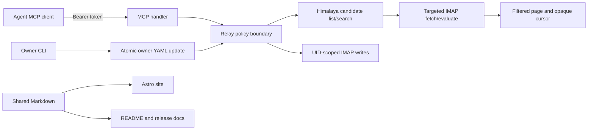

# feat: Complete MCP parity and prepare a public release

## Summary

Complete the token-authenticated MCP relay before publishing it: add safe mutation and Himalaya-backed paginated search, make the testing CLI use MCP, provide secure owner token lifecycle commands, then publish canonical documentation, an Astro site, and reproducible Linux/macOS releases.

---

## Problem Frame

Sireno’s current source tree is midway through the MCP migration. Read tools, attachments, token hashes, and audit logging exist, but writes, pagination/search, agent CLI parity, deployment examples, release automation, and public documentation are incomplete or still describe retired IMAP/SMTP interfaces. Publishing now would give owners inaccurate security and operational guidance.

---

## Requirements

- R1. Publish only tested, shipped behavior; full MCP parity is the public-release gate. (see origin: `docs/brainstorms/2026-10-16-public-documentation-and-release-requirements.md`)
- R2. Preserve the least-privilege MCP security boundary and document its limits accurately.
- R3. Implement safe, policy-filtered mail reads, Himalaya-backed pagination/search, sending, and explicitly scoped mailbox/folder writes.
- R4. Provide complete owner user/token lifecycle commands without persisting or logging raw tokens.
- R5. Replace stale documentation with concise shared Markdown covering every supported configuration option, CLI command, local setup, and private Docker setup.
- R6. Publish Linux/macOS amd64/arm64 artifacts, checksums, a Homebrew formula, and an Astro marketing/documentation site on GitHub Pages.

**Origin actors:** A1 (owner), A2 (agent operator), A3 (agent), A4 (maintainer).
**Origin flows:** F1 (provision an agent), F2 (choose an installation path), F3 (publish a release).
**Origin acceptance examples:** AE1 (security boundary), AE2 (configuration reference), AE3 (token lifecycle), AE4 (local/Docker onboarding).

---

## Scope Boundaries

### Deferred for later

- Windows artifacts and package managers beyond Homebrew.
- Search predicates that Himalaya cannot evaluate safely upstream, including attachment-content predicates.
- Cross-host deployment, OAuth authorization, and additional provider backends.

### Outside this product's identity

- Agent access to provider credentials, owner files, direct upstream networking, or a raw upstream-command MCP tool.
- Logging bearer tokens, provider passwords, attachment bytes, or raw audit capture to stdout.

### Deferred to Follow-Up Work

- The old `docs/plans/2026-10-13-001-feat-token-authenticated-mcp-mail-relay-plan.md` remains historical context; this plan replaces its incomplete execution path rather than preserving duplicate units.

---

## Context & Research

### Relevant Code and Patterns

- `internal/config/config.go` owns strict owner-only YAML loading, environment interpolation, validation, and current provider/profile/user/logging schema.
- `internal/relay/relay.go`, `internal/view/view.go`, `internal/policy/policy.go`, and `internal/mail/message.go` form the policy-filtered virtual-mail domain. The view currently reads every raw message and maps virtual IDs without upstream UIDVALIDITY.
- `internal/provider/provider.go` has only folders, full-folder reads, and SMTP send; no targeted IMAP mutation or candidate fetch API exists.
- `internal/mcp/server.go` has authenticated list/read/attachment tools but no pagination, search, send, or write tools. `cmd/sireno/main.go` still contains direct IMAP/SMTP agent CLI behavior.
- `internal/imap/server.go` contains usable search semantics but belongs to the retired agent-facing protocol path; it must not remain an alternate authority path.
- `config.example.yml`, `README.md`, `docs/configuration.md`, `docs/security.md`, and `docs/operations.md` are the current public documentation surface and contain stale protocol statements.
- `Makefile` already embeds `main.version` for local builds. `skill-organizer` provides the requested tag-triggered GoReleaser/Homebrew release pattern.

### Institutional Learnings

- No `docs/solutions/` learning documents exist in this repository.

### External References

- Himalaya 2.2.1 exposes `envelope list`/`envelope search` pagination and grouped query syntax, plus IMAP search criteria including From, To, Cc, Subject, Body, and received-date filters. Its result counts are upstream counts and must not be exposed as filtered totals.
- Astro’s content loader can load shared Markdown from a configured base path; its GitHub Pages guidance uses `site`/`base`, the Astro action, and `actions/deploy-pages`.
- GoReleaser v2 supports Linux/macOS archives, checksums, GitHub releases, and a Homebrew tap through its `brews.repository` configuration.

---

## Key Technical Decisions

| Decision | Rationale |
| --- | --- |
| One release plan supersedes unfinished execution units in the prior MCP plan | Prevents competing definitions of the release gate while retaining previous rationale and tests as context. |
| Generate an owner-only temporary Himalaya configuration from the selected Sireno provider | Himalaya’s CLI needs account configuration but owners must not duplicate or expose upstream credentials; temporary material must be restricted, bounded, and removed on every exit path. |
| Treat upstream search/list results only as candidates | Sireno must re-fetch/evaluate policy before returning each message. It must never expose upstream counts, IDs, folder names, or candidates rejected by policy. |
| Opaque, filtered pagination cursors and page size capped at 20 | Cursors track filtered scan progress without exposing upstream offsets; exact totals appear only when the filtered search completes. |
| Owner CLI mutates configuration through an atomic, owner-only replacement | User/token commands update only selected YAML nodes, preserve existing mode/ownership, validate before installation, and never send generated tokens through argv, logs, or non-TTY stdout. |
| Shared Markdown is the public source of truth | The README and Astro site link/render the same reference content, avoiding diverging configuration documentation. |

---

## High-Level Technical Design

> *This illustrates the intended approach and is directional guidance for review, not implementation specification. The implementing agent should treat it as context, not code to reproduce.*



---

## Output Structure

```text
docs/
  public/                 # canonical owner/agent-facing Markdown
  examples/
    compose.yml
website/                  # Astro marketing site and shared-doc renderer
  src/
  public/
.github/workflows/
  ci.yml
  release.yml
  deploy-site.yml
.goreleaser.yaml
```

---

## Implementation Units

### U1. Establish safe provider mutation and durable virtual identities

**Goal:** Extend the provider and virtual view with the targeted, revalidated primitives required for policy-safe writes.

**Requirements:** R1, R2, R3; Covers origin R2, R3 and F1.

**Dependencies:** None.

**Files:**
- Modify: `internal/provider/provider.go`, `internal/view/view.go`, `internal/relay/relay.go`, `internal/policy/policy.go`
- Create: `internal/provider/provider_test.go`
- Modify: `internal/view/view_test.go`, `internal/relay/relay_test.go`, `internal/policy/policy_test.go`
- Delete or retire: `internal/imap/server.go`, `internal/imap/server_test.go`, `internal/smtp/server.go`, `internal/smtp/server_test.go` once MCP parity covers their agent-facing behavior

**Approach:** Add capability-gated IMAP operations for UID-scoped flag changes, move/copy, append, targeted deletion, and only folder operations whose effects can be proven scoped to visible writable resources. Bind virtual records to upstream UIDVALIDITY, UID, evaluated content fingerprint, and folder identity; re-fetch/re-evaluate immediately before mutation. Preflight every batch target and reject unavailable capability, stale identity, hidden content, mixed authorization, or any operation that would require blanket expunge or unsafe folder-wide effects. Return explicit partial/unknown outcomes after upstream acceptance.

**Execution note:** Start with characterization and safety tests for current virtual-ID behavior, then implement mutation APIs test-first.

**Patterns to follow:** `internal/view/view.go` owner-only state writes; `internal/mail/message.go` fail-closed evaluation; `internal/policy/policy.go` deny-overrides-allow behavior.

**Test scenarios:**
- Happy path: a visible `rw` message can receive a UID-targeted flag change, move/copy to an authorized destination, and an allowed append receives a new virtual ID.
- Edge case: changed UIDVALIDITY, changed raw content, renamed mailbox, or recycled upstream UID makes the old virtual target unavailable.
- Error path: `ro` source, denied destination, hidden target, unsafe append, unsupported provider capability, and mixed-validity batch cause zero upstream effects.
- Integration: a hidden `\\Deleted` message cannot be expunged while deleting a visible message; attempted folder deletion/rename cannot affect hidden mail.

**Verification:** Every mutation is tied to an evaluated current virtual target and no fallback can perform a broad upstream effect.

### U2. Add Himalaya-backed candidate paging and filtered search

**Goal:** Provide bounded list/search pages without recovering an entire mailbox before a search, while retaining the filtered-view invariants.

**Requirements:** R1, R2, R3; Covers origin R2, R3 and AE2.

**Dependencies:** U1.

**Files:**
- Modify: `internal/config/config.go`, `internal/provider/provider.go`, `internal/view/view.go`, `internal/relay/relay.go`, `internal/mcp/server.go`
- Create: `internal/provider/himalaya.go`, `internal/provider/himalaya_test.go`, `internal/mcp/search_test.go`
- Modify: `internal/config/config_test.go`, `internal/view/view_test.go`, `internal/relay/relay_test.go`, `internal/mcp/server_test.go`

**Approach:** Build a temporary 0600 Himalaya configuration from the selected provider and invoke its IMAP/envelope list/search commands with strict timeouts, bounded output, no shell, and cleanup on all paths. Translate only the approved grouped expression fields that Himalaya can evaluate safely upstream; reject unsupported predicates rather than silently scanning all mail. Use returned IDs only as candidates, then targeted-fetch and evaluate enough candidates to fill a 20-item filtered page. Encode only filtered continuation state in an opaque cursor. Search all readable folders in a stable ordering; list uses the same page envelope. Do not return an upstream count or estimate; return `total_visible` only once the filtered scan establishes it.

**Technical design:** The expression layer accepts grouped `and`, `or`, and `not` for supported sent/received date, From, To, Cc, Subject, Body, and Folder criteria. Attachment predicates remain explicitly unsupported until a permitted-attachment-aware upstream strategy exists.

**Patterns to follow:** `internal/provider.Secret` command timeout/output limits; `internal/mcp/server.go` structured tool results; `internal/view/view.go` filtered candidate evaluation.

**Test scenarios:**
- Happy path: list/search return 20 or fewer visible messages, page metadata, and a cursor that produces the next filtered page without duplication.
- Edge case: first upstream candidate page is mostly hidden; Sireno advances candidates until it fills the visible page or reaches exhaustion without revealing skipped count/offset.
- Error path: invalid grammar, unsupported attachment predicate, malformed Himalaya JSON, timeout, temporary-config failure, expired/tampered cursor, and upstream candidate fetch failure return redacted errors and no partial hidden data.
- Integration: a grouped date/address/body query executes through the Himalaya runner, then returns only policy-visible virtual UIDs and folders.

**Verification:** Search never invokes a full-folder raw-mail fetch as its initial strategy and no MCP response reveals unfiltered candidates or counts.

### U3. Complete the MCP tool contract and testing CLI parity

**Goal:** Expose all released reads, writes, search, and sending through MCP, and make `sireno-relay mail` a warning-bearing MCP client rather than an alternate provider path.

**Requirements:** R1, R2, R3, R4; Covers origin R2, R3, R6 and AE1.

**Dependencies:** U1, U2.

**Files:**
- Modify: `internal/mcp/server.go`, `internal/mcp/server_test.go`, `internal/relay/relay.go`, `cmd/sireno/main.go`, `cmd/sireno/main_test.go`
- Create: `internal/mcp/tools_test.go`, `internal/mcp/client.go`, `internal/mcp/client_test.go`
- Modify: `go.mod`, `go.sum` only if required by the selected official MCP client API

**Approach:** Add bounded send and mutation tools with schemas that accept virtual IDs/cursors only. Recheck current authorization before results and immediately before irreversible provider I/O. Keep generic unavailable/denied responses where disclosure would leak hidden resources. Refactor all `mail` subcommands to accept an endpoint and bearer token via environment/configured secret, call the same MCP transport, keep machine-readable stdout clean, emit the testing-only warning on stderr, and reject URL userinfo, redirects, and proxy/credential leakage.

**Execution note:** Start with black-box MCP HTTP tests for token isolation, stale-write rejection, and CLI/tool parity.

**Patterns to follow:** `internal/mcp/server.go` per-request bearer authentication; `internal/relay/relay.go` send recheck; Cobra/Viper conventions in `cmd/sireno/main.go`.

**Test scenarios:**
- Happy path: an authenticated agent discovers, pages, searches, reads, sends, and performs each supported write only in authorized scope.
- Edge case: token rotation during a page/read/write, a stale cursor/virtual ID, and two tokens with distinct views cannot cross identities or infer hidden totals.
- Error path: bad bearer, invalid origin/body/schema, denied recipient, scanner failure, failed upstream operation, unknown send outcome, unsafe redirect/proxy, and absent CLI token fail without credential output.
- Integration: Covers AE1. MCP and testing CLI return equivalent authorization outcomes for a denied read, search, send, and write.

**Verification:** No agent-facing executable path loads owner config or directly connects to upstream mail after the refactor.

### U4. Add owner user and bearer-token lifecycle commands

**Goal:** Let an owner safely add, edit, and rotate users without manually hashing tokens or corrupting owner YAML.

**Requirements:** R4; Covers origin R9, R10, F1, and AE3.

**Dependencies:** U3.

**Files:**
- Modify: `cmd/sireno/main.go`, `cmd/sireno/main_test.go`, `internal/config/config.go`, `internal/config/config_test.go`, `internal/relay/relay.go`, `internal/relay/relay_test.go`
- Create: `internal/config/write.go`, `internal/config/write_test.go`

**Approach:** Add owner-only `user add`, `user edit`, and `user rotate-token` commands. Validate provider/profile references before altering configuration; generate high-entropy opaque tokens and hash them using the existing verifier algorithm. Require an interactive terminal for raw-token display, reveal it exactly once, and refuse non-TTY output. Perform config-node mutation and atomic replacement while preserving owner-only permissions and retaining unrelated YAML content/comments where feasible. An edit changes only requested bindings/settings; token rotation is explicit.

**Patterns to follow:** `config.Load` ownership/known-field validation; `view.Store.save` temporary-file/fsync/rename pattern; Cobra command conventions.

**Test scenarios:**
- Happy path: add generates a token, installs only its verifier, and an added user authenticates through MCP; edit changes profile/provider without changing verifier; explicit rotation invalidates the old token.
- Edge case: a user name with invalid characters, existing user, unchanged edit, and simultaneous valid config reload preserve a valid owner configuration.
- Error path: non-TTY invocation, invalid provider/profile, unsafe config mode/owner, write/fsync/rename failure, and invalid rewritten YAML leave the previous config untouched and never print a token.
- Integration: Covers AE3. A token displayed by add/rotate selects only the newly configured user on the next MCP request.

**Verification:** Raw tokens exist only in interactive terminal memory/output at generation time; configuration contains only token hashes.

### U5. Publish isolated deployment materials and canonical documentation

**Goal:** Replace stale interface documentation with concise, complete release documentation and reproducible local/Docker guidance.

**Requirements:** R1, R2, R5; Covers origin R3-R8, F2, AE1, AE2, and AE4.

**Dependencies:** U1-U4.

**Files:**
- Create: `docs/public/index.md`, `docs/public/getting-started-local.md`, `docs/public/getting-started-docker.md`, `docs/public/configuration.md`, `docs/public/cli.md`, `docs/public/security.md`, `docs/public/operations.md`
- Create: `docs/examples/compose.yml`, `docs/examples/Dockerfile`
- Modify: `README.md`, `config.example.yml`, `docs/examples/relay.service`, `docs/configuration.md`, `docs/security.md`, `docs/operations.md`, `docs/policy.md`
- Delete: stale duplicate public pages after their canonical replacement is linked and verified

**Approach:** Make `docs/public/` the single canonical Markdown source. Explain Sireno’s limited-resource goal, threat model, provider/profile/user relationship, static bearer-token boundary, explicit limits, and default-deny policy before reference material. Provide a field-by-field configuration reference generated/reviewed against schema, including defaults and all rule/mode values. Document owner CLI and MCP/testing CLI separately. Provide complete local and Docker quick starts with no live credentials; Docker demonstrates agent–relay internal networking, relay-only upstream egress, no published MCP port by default, separate mounts/users, and HTTPS requirement beyond one trusted host. Reduce README to product overview, feature summary, install entry points, and links to canonical docs.

**Patterns to follow:** `config.example.yml` comments and strict schema; `docs/security.md` threat-limit language; `docs/examples/relay.service` owner-service model.

**Test scenarios:**
- Happy path: Covers AE2 and AE4. Every documented configuration key parses under `config-check`; both quick-start examples validate and their MCP configuration references an environment token.
- Edge case: each enum/default/pattern example in canonical docs agrees with the schema; Docker configuration has no agent mount of owner config/state or upstream credentials.
- Error path: documentation validation rejects stale `listen.imap`, agent password, raw token, or unsupported tool/protocol claims.
- Integration: Covers AE1. A documented agent container can reach the relay but not owner files or upstream mail endpoints.

**Verification:** A new owner can complete either setup solely from canonical docs, and no public document describes retired IMAP/SMTP agent access.

### U6. Build the Astro marketing site from shared documentation

**Goal:** Publish a feature-led public site without duplicating the reference documentation.

**Requirements:** R5, R6; Covers origin R12.

**Dependencies:** U5.

**Files:**
- Create: `website/package.json`, `website/pnpm-lock.yaml`, `website/astro.config.mjs`, `website/tsconfig.json`, `website/src/content.config.ts`
- Create: `website/src/pages/index.astro`, `website/src/pages/docs/[...slug].astro`, `website/src/layouts/*`, `website/src/components/*`, `website/src/styles/*`, `website/public/*`
- Modify: `README.md`, `docs/public/index.md`
- Test: `website/src/**/*.test.*` or the selected Astro build/validation configuration

**Approach:** Create a static Astro site with a marketing homepage focused on least-privilege email access, policy filtering, safe attachment handling, auditability, Docker isolation, and MCP compatibility. Load `docs/public/` as the docs collection rather than copying content. Configure GitHub Pages `site` and repository `base` values through deploy-time settings. Keep the landing page’s security claims consistent with canonical security documentation and offer clear install/documentation calls to action.

**Patterns to follow:** Astro content collection and GitHub Pages deployment guidance; canonical Markdown from U5.

**Test scenarios:**
- Happy path: production build renders landing page and every canonical docs page with working navigation and links.
- Edge case: repository Pages base path is applied to assets, internal docs links, and installation links.
- Error path: an invalid/missing Markdown frontmatter field or broken documentation link fails the site validation/build.

**Verification:** The deployed static artifact contains both the marketing page and rendered canonical documentation, with no duplicate hand-maintained reference copy.

### U7. Automate verification, releases, Homebrew, and GitHub Pages

**Goal:** Turn tested tags into reproducible public artifacts and deploy the site from the same source.

**Requirements:** R1, R6; Covers origin R11, R12, F3.

**Dependencies:** U5, U6.

**Files:**
- Create: `.goreleaser.yaml`, `.github/workflows/ci.yml`, `.github/workflows/release.yml`, `.github/workflows/deploy-site.yml`
- Modify: `Makefile`, `README.md`, `website/package.json`

**Approach:** Add CI that runs Go validation, documentation/config-example checks, and site build checks. Add tag-triggered GoReleaser configuration for Linux/macOS amd64/arm64 archives, checksums, GitHub release notes, embedded version metadata, and `sergiocarracedo/homebrew-tap` formula publishing with a repository secret. Add a GitHub Pages workflow using the Astro action and Pages deployment permissions. Make release jobs depend on verification, use pinned major action versions consistent with current official guidance, and document the required repository secret/settings.

**Patterns to follow:** `Makefile` version linker flag; the referenced `skill-organizer` release workflow and GoReleaser structure, adjusted to Sireno’s actual binary and no unrelated telemetry/npm jobs.

**Test scenarios:**
- Happy path: release configuration produces archives/checksums for all four Linux/macOS architecture combinations and a tap formula referencing those artifacts.
- Edge case: prerelease tags do not publish a stable Homebrew formula; site deployment builds correctly under the repository Pages base path.
- Error path: missing Homebrew token, failed Go/site/docs validation, or absent Pages permissions fails before a partial public release is marked successful.
- Integration: Covers F3. A release tag runs verification before publishing artifacts and the released binary reports the tag version.

**Verification:** A maintainer can follow documented repository setup to publish a tagged release and install it with Homebrew on supported Linux/macOS hosts.

---

## System-Wide Impact

- **Interaction graph:** Agent MCP and testing CLI use the same authenticated relay; owner token CLI changes the next active configuration generation; Himalaya narrows upstream candidates while the provider/view layer remains the sole authorization boundary.
- **Error propagation:** Himalaya, provider, parser, policy, cursor, mutation, and config-write failures return generic agent-facing errors and detailed safe owner audit events; no error output includes raw secrets or hidden metadata.
- **State lifecycle risks:** Temporary Himalaya configuration cleanup, cursor expiry, UIDVALIDITY/fingerprint staleness, token replacement, in-flight mutations, and partial upstream commits require explicit tests and audit records.
- **API surface parity:** MCP and `mail` CLI must exercise the same contract; retired IMAP/SMTP listeners must be removed from runtime/docs to avoid bypasses.
- **Integration coverage:** Use fake provider/Himalaya runners for deterministic cases, actual Streamable HTTP MCP request tests, and Docker composition checks for filesystem/network isolation.
- **Unchanged invariants:** Provider credentials remain owner-only; policy remains default-deny; failed MIME/scanner evaluation remains invisible; bearer tokens are never logged; raw attachment download bytes are never audit-captured.

---

## Risks & Dependencies

| Risk | Mitigation |
| --- | --- |
| Himalaya’s result schema/UID behavior differs across supported versions | Pin a supported minimum version, characterize JSON/UID behavior with fixtures, and fail closed on an unexpected result. |
| Temporary Himalaya config exposes upstream credentials | Use an owner-only temporary directory/files, no shell, bounded command lifecycle, cleanup on every exit path, and never log generated config. |
| Search pagination leaks hidden messages through count or cursor | Return filtered pages/cursors only; suppress upstream counts and positions; test hidden-heavy candidate pages. |
| IMAP writes affect hidden/concurrent content | Gate each provider operation on UID-targeted semantics, fresh revalidation, UIDVALIDITY, and explicit partial/unknown outcomes. |
| YAML mutation loses comments or leaves partial config | Mutate YAML nodes, validate the complete replacement, fsync/rename atomically, and retain original file on any failure. |
| Public docs drift from behavior | Make release CI validate schema/examples/docs and build the site from the same Markdown source only after parity tests pass. |
| Docker sample overstates isolation | State the host-root/same-network limits plainly and test mount/network topology; do not claim containment beyond Docker’s actual boundary. |
| Homebrew publication requires cross-repository credentials | Document `HOMEBREW_TAP_GITHUB_TOKEN` setup and make release fail early when it is absent. |

---

## Open Questions

### Resolved During Planning

- **Himalaya account configuration:** Sireno generates an ephemeral owner-only configuration from the selected provider rather than requiring a separate user-maintained Himalaya account.
- **Search count privacy:** No unfiltered estimate is exposed; totals are returned only when known for the filtered result set.
- **Public release target:** Linux/macOS amd64/arm64, Homebrew tap, and GitHub Pages; Windows is deferred.
- **Raw token handoff:** Generated token is terminal-only and available once from an interactive owner command.

### Deferred to Implementation

- **Supported Himalaya output shape/version floor:** Confirm against the selected binary and fixture responses before freezing the runner parser.
- **Exact folder mutation subset:** Expose only operations the IMAP backend proves safe; unsupported capabilities remain absent from the tool catalogue.
- **Markdown frontmatter/navigation format:** Select the smallest shared format that validates both repository links and Astro docs collection loading.

---

## Documentation and Operational Notes

- The release checklist must block publication until all U1-U5 behavior and isolation tests pass; docs/site work must not be used to imply parity beforehand.
- Public examples use placeholders and `{env:...}` references only. They must never contain a raw generated token, provider password, user-local path, or a public MCP port by default.
- Audit content capture remains an owner forensic feature, requires an owner-only file target, and must be described separately from normal safe operational logging.
