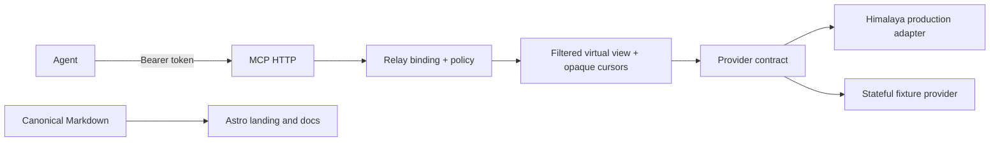

# feat: Complete verified relay parity and public website

## Summary

Finish Sireno as a production-quality token-authenticated MCP mail relay, prove its access rules through a stateful fixture provider and real MCP HTTP tests, publish canonical documentation, and add an Astro landing/docs site. Public claims and releases remain blocked by any operation whose Himalaya behavior is not proven target-scoped.

---

## Scope

- Complete visible-only 20-message list/search pagination, including hidden-heavy candidate scans and opaque cursor invalidation.
- Make the provider contract capability-complete for supported safe operations; unsupported capabilities return `capacity unavailable` with no upstream I/O.
- Add a reusable, stateful fixture provider with multiple accounts, folders, messages, MIME variants, attachments, failures, and mutation recording.
- Exercise the fixture through real authenticated Streamable HTTP MCP requests, including policy/token changes between operations.
- Add canonical public Markdown, an Astro static landing/docs site, and GitHub Pages build/deploy automation from verified documentation.

### Safety boundaries

- Himalaya remains the sole production upstream backend; no direct Go IMAP/SMTP fallback is reintroduced.
- Copy, move, deletion, append, and folder mutations remain unavailable until an isolated Himalaya characterization proves exact target scope and safe failure semantics.
- No raw token, credential, or attachment bytes may be placed in command arguments, URLs, normal logs, fixtures, site examples, or generated documentation.

---

## Architecture

The fixture implements the same provider contract but is test-only. Himalaya narrows candidates; the view re-evaluates content and policy before virtual IDs become visible. A cursor contains no upstream page, ID, count, or folder metadata and is bound to the authenticated user/provider/policy context.

---

## Implementation Units

### U1. Finish filtered candidate paging and search

**Goal:** Fill pages with up to 20 visible messages while hiding denied candidates, and safely invalidate cursors when binding/policy state changes.

**Files:** Modify `internal/provider/provider.go`, `internal/provider/himalaya.go`, `internal/view/view.go`, `internal/relay/relay.go`, `internal/mcp/server.go`; modify tests under `internal/provider/`, `internal/view/`, `internal/relay/`, and `internal/mcp/`.

**Approach:** Continue scanning bounded upstream candidate pages until 20 visible messages are accumulated or the query is exhausted. Preserve deferred visible candidates within cursor state rather than dropping them. Reject unsupported/invalid Himalaya query grammar before upstream execution. Revalidate token, provider, policy, and visibility on every cursor use.

**Test scenarios:** Hidden-heavy first candidates; exact 20/21 visible messages; no duplicate or skipped visible item; cross-user/tampered/expired cursor; policy/token rotation; malformed provider page and scan-budget exhaustion; read of a later-page virtual ID.

### U2. Add a stateful provider fixture and MCP safety battery

**Goal:** Make access-rule regressions observable through deterministic real HTTP MCP tests.

**Files:** Create `internal/provider/fixture/fixture.go` and `internal/provider/fixture/fixture_test.go`; create `internal/mcp/safety_integration_test.go`; modify `internal/mcp/server_test.go` and `internal/relay/relay_test.go`.

**Approach:** Seed multiple reusable providers and policies with hundreds of messages across readable, hidden, and writable folders. Record every candidate read, raw fetch, send, and mutation. Drive initialization, tool discovery, calls, and attachment routes through `mcp.Handler`; assert both returned data and forbidden provider calls.

**Test scenarios:** Shared provider with distinct policies; shared policy on distinct providers; mixed visibility search/list pages; denied MIME/attachment revocation; stale content/generation; rotation during send/write; capacity unavailable with zero I/O; malformed/timeout/unknown provider outcomes; no hidden IDs/counts/secrets/bytes in responses or audit events.

### U3. Complete only proven MCP operations

**Goal:** Expose sending, flags, and any future operation through one capability-gated MCP contract.

**Files:** Modify `internal/provider/provider.go`, `internal/provider/himalaya.go`, `internal/relay/relay.go`, `internal/mcp/server.go`, and associated tests.

**Approach:** Characterize each Himalaya command with runner fixtures and isolated backend tests. Advertise a capability only after target identity, mailbox generation, policy recheck, and uncertain-outcome behavior are established. Keep all unproven operations registered only when a safe tool contract exists; otherwise document them as unavailable rather than implementing unsafe fallbacks.

**Test scenarios:** Authorized send/flag operation; denied recipient/folder/target; mixed-validity batch; target replacement; capability disabled; non-target side-effect prevention; unknown send acknowledgment.

### U4. Create canonical public documentation

**Goal:** Ensure every user-facing claim describes tested behavior and one source powers README and website docs.

**Files:** Create `docs/public/`; modify `README.md`, `config.example.yml`, `docs/configuration.md`, `docs/security.md`, `docs/policy.md`, and `docs/operations.md`.

**Approach:** Establish concise Markdown for product overview, local setup, token provisioning, configuration, MCP tools, security model, operations, and known unavailable capabilities. Use placeholders only and validate documented configuration examples against the real schema.

**Test scenarios:** Config snippets validate; no stale agent IMAP/SMTP or raw-token claims; each listed tool/capability exists; links resolve.

### U5. Build the Astro landing and documentation site

**Goal:** Ship a distinctive static product landing page and docs renderer without duplicating Markdown.

**Files:** Create `website/` with Astro configuration, pages, layouts, styles, content loader, and public assets; create `.github/workflows/deploy-site.yml`; modify CI and README links as needed.

**Approach:** Use Astro with `docs/public/` as the documentation source. Design the landing around Sireno’s limited-access MCP boundary, clear capability status, policy isolation, and owner/operator workflow. Configure repository-base-aware assets and GitHub Pages deployment. Verify rendered output visually and through a production build.

**Test scenarios:** Landing/mobile layouts; every docs slug; broken Markdown/link failure; repository Pages base path; static build; screenshot review of key screens.

---

## Release gate

Do not make public parity or mutation claims until U1–U3 fixture and adapter evidence passes. The site/docs may ship an explicit capability matrix that marks unsupported operations unavailable; release automation must validate both Go and website builds.
